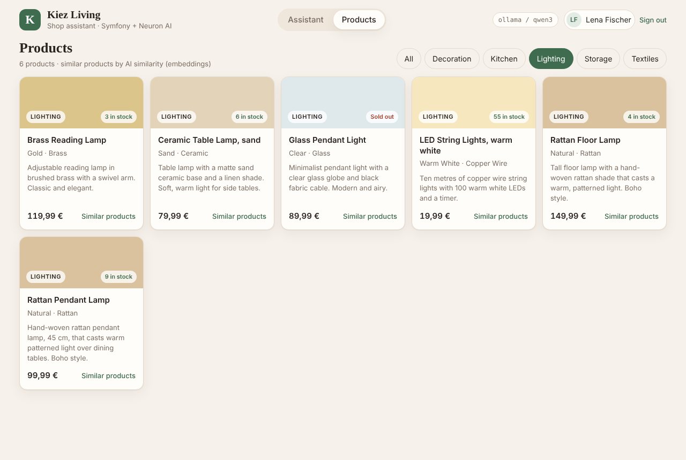
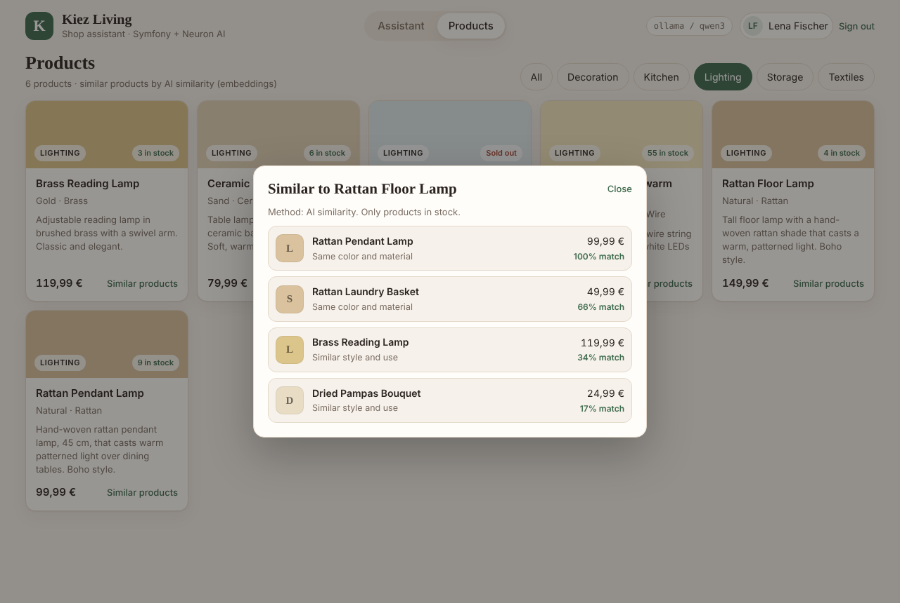
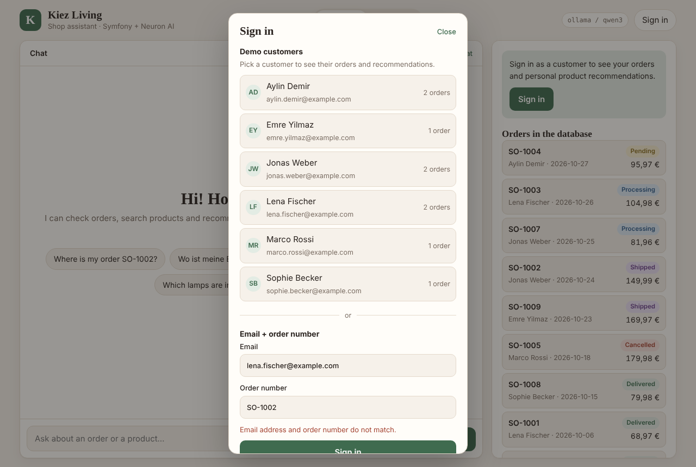
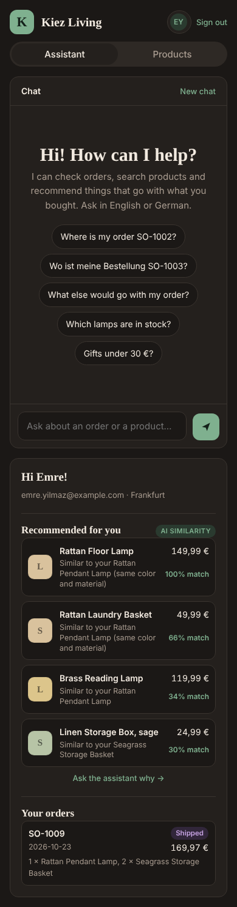

# Kiez Living – AI Shop Assistant

An AI customer service agent built with **Symfony** and **[Neuron AI](https://docs.neuron-ai.dev/)**. It checks order status, searches products and recommends products, using real data from the database.


**Tech stack:** PHP 8.4, Symfony 7.4, Neuron AI, MySQL, Docker, PHPUnit
**Tested with:** Ollama (Qwen 3.6 for chat, `nomic-embed-text` for embeddings)

## Features

- **AI agent with tools:** the model decides which tool to call (`find_order`, `search_products`, `recommend_products`); each tool runs a SQL query
- **AI recommendations:** product embeddings (768-dim vectors) + cosine similarity, combined with business rules
- **Secure recommendations:** the customer ID comes from the server session, so the agent can't read another customer's purchases
- **Any AI provider:** Ollama, Claude, OpenAI or Gemini via `.env`
- **Tested** with Neuron's `FakeAIProvider`, no API key needed

## Screenshots

| Products page | Similar products (AI embeddings) |
|---|---|
|  |  |

| Sign-in (wrong order number rejected) | Mobile, dark mode |
|---|---|
|  |  |

## Quick start

```bash
ollama pull nomic-embed-text
cp .env.local.example .env.local   # set AI_MODEL to your chat model, as shown by `ollama list`
docker compose up --build
```

Open http://localhost:8000, sign in with `lena.fischer@example.com` + `SO-1001` and ask: *"What else would go with my order?"*
